# MotoGear Shop code structure and sequence diagrams

These diagrams describe the current implementation in this repository. The
`.mmd` files are the editable Mermaid sources; matching SVG files are scalable
images, and PNG files are convenient previews for GitHub and other viewers.

## Workspace structure

| Area | Responsibility | Important code |
| --- | --- | --- |
| Browser assets | Catalogue, cart, checkout retry state, order history, notifications. The API serves these files and the JavaScript runs in the visitor's browser. | `web/index.html`, `web/app.js`, `web/styles.css` |
| API | Axum routes, request/response DTOs, error mapping, shared app state | `crates/api/src/routes/`, `crates/api/src/dto/`, `crates/api/src/error.rs` |
| Domain | Money, quantities, order-request validation, order status transitions | `crates/domain/src/` |
| Persistence | PostgreSQL queries and transactions for catalogue, orders, outbox, inventory, shipment, and notifications | `crates/persistence/src/` |
| Workers | One publisher binary and three independent consumer binaries; they share parsing, retry, deduplication support, and shutdown handling. | `crates/workers/src/bin/`, `crates/workers/src/runtime/` |
| Infrastructure | PostgreSQL and Kafka, migrations, topic creation, application containers | `compose.yaml`, `Dockerfile`, `migrations/` |

The architecture picture separates repository/build targets from the running
system. Dashed arrows show crate or build dependencies; solid arrows show
runtime traffic. The `motogear-workers` crate builds four separate processes:
the publisher, inventory consumer, fulfillment consumer, and notifications
consumer. The browser source lives in the repository but executes on the
visitor's machine. The API validates and translates HTTP requests, persistence
owns database transactions, and workers move domain events between PostgreSQL
and Kafka. The browser never supplies a trusted price or stock value.

## Diagrams

### Workspace architecture

Separates source/build dependencies from runtime processes and network traffic.

Source: [architecture.mmd](architecture.mmd) · Images: [SVG](images/architecture.svg) | [PNG](images/architecture.png)

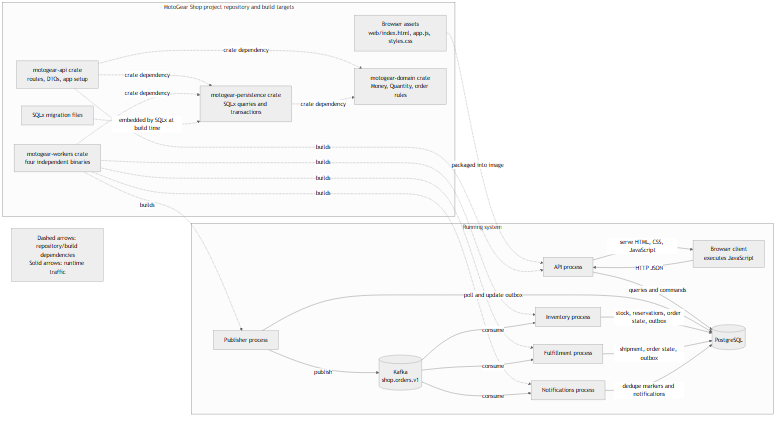

### Browse the catalogue

Shows the browser's actual initial limit of 100 for both customers and
products, API pagination validation, and database failure handling.

Source: [catalogue.mmd](catalogue.mmd) · Images: [SVG](images/catalogue.svg) | [PNG](images/catalogue.png)

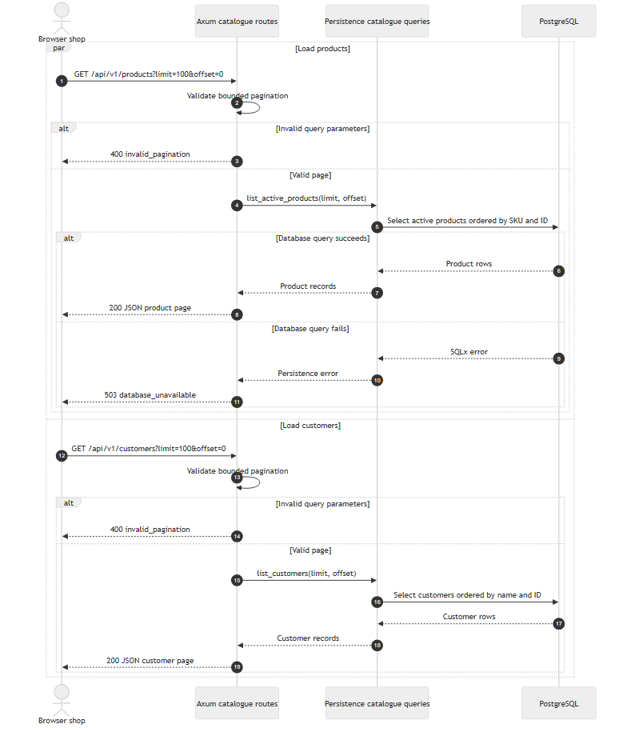

### Submit an order

Shows request validation, customer and active-product checks, current-price
calculation, transaction boundaries, idempotent replay/conflict behavior, and
the `OrderCreated` outbox insert. Inventory is not reserved during checkout.

Source: [order-submission.mmd](order-submission.mmd) · Images: [SVG](images/order-submission.svg) | [PNG](images/order-submission.png)

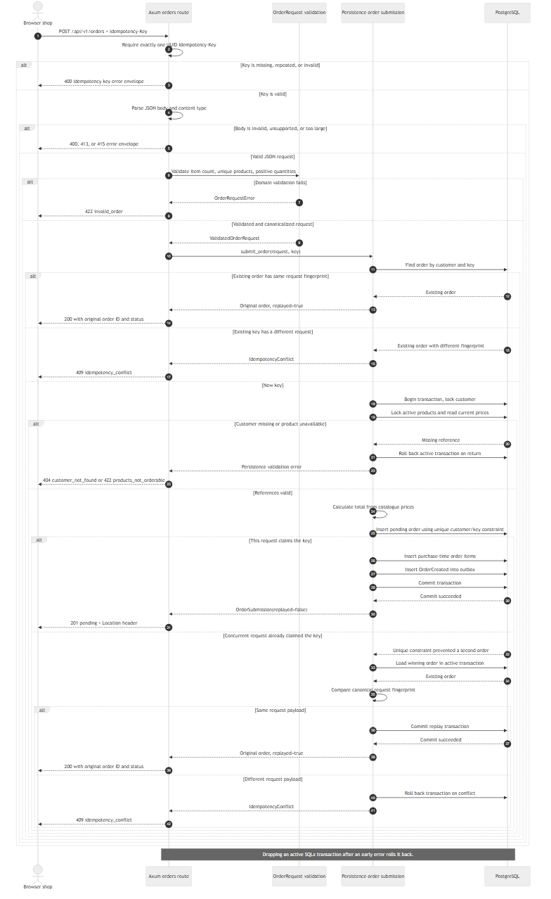

### Publish outbox events

Shows the publisher polling PostgreSQL, delivering to Kafka, marking success,
and recording retryable failures. Delivery is at least once.

Source: [outbox-publisher.mmd](outbox-publisher.mmd) · Images: [SVG](images/outbox-publisher.svg) | [PNG](images/outbox-publisher.png)

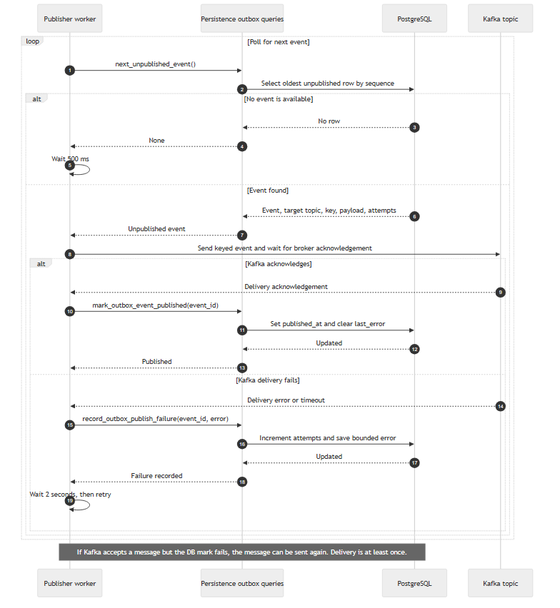

### Reserve inventory

Shows event validation and deduplication, stock locking, atomic reservation,
and the accepted/rejected follow-up event.

Source: [inventory.mmd](inventory.mmd) · Images: [SVG](images/inventory.svg) | [PNG](images/inventory.png)

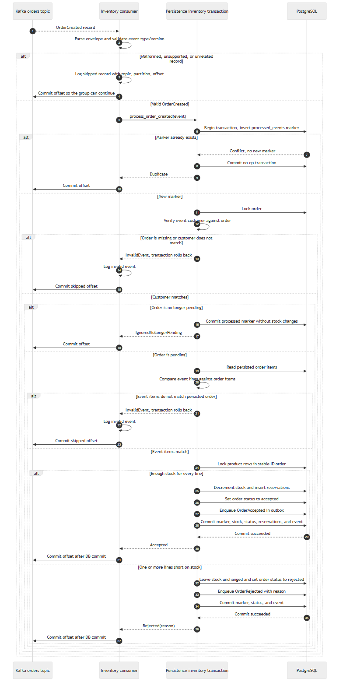

### Fulfill an accepted order

Shows the replay pre-check, optional simulation delay, transactional duplicate
check, already-shipped guard, shipment creation, status update, and
`OrderShipped` outbox event.

Source: [fulfillment.mmd](fulfillment.mmd) · Images: [SVG](images/fulfillment.svg) | [PNG](images/fulfillment.png)

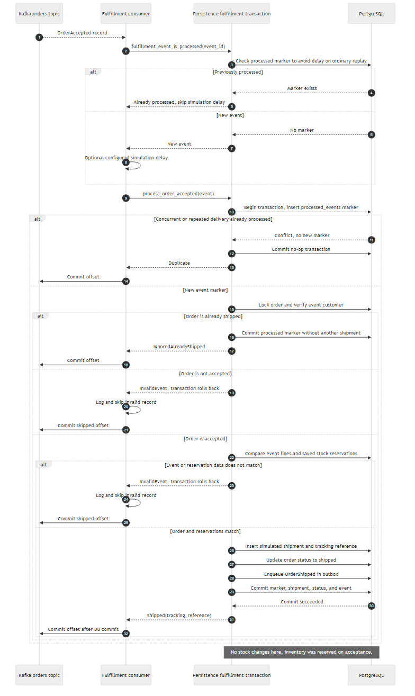

### Create customer notifications

Shows lifecycle event handling, semantic payload validation, transactional
event deduplication and notification insert, then Kafka offset commit. Invalid
events are logged and skipped rather than durably quarantined.

Source: [notifications.mmd](notifications.mmd) · Images: [SVG](images/notifications.svg) | [PNG](images/notifications.png)

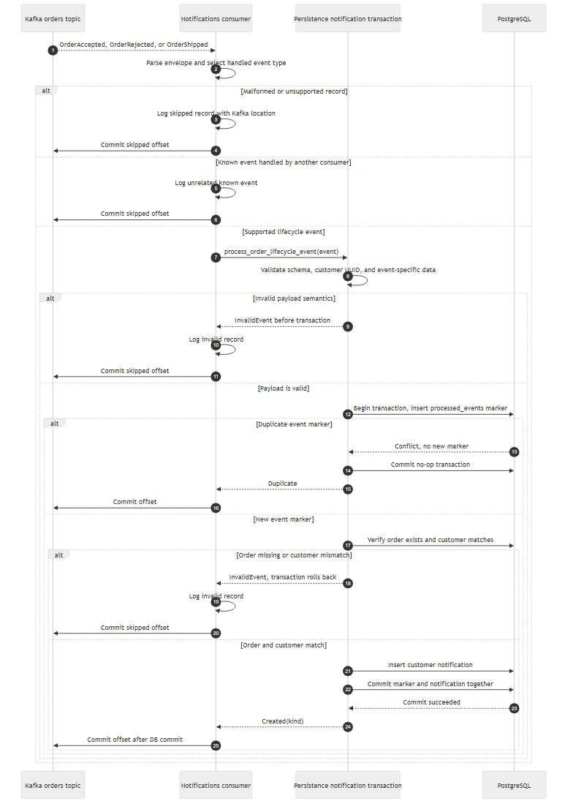

### Read order history and notifications

Shows `GET /api/v1/orders/{order_id}`, customer order history, and newest
notifications. Order detail and history read headers, shipment data, and items
from a consistent read-only repeatable-read snapshot.

Source: [read-models.mmd](read-models.mmd) · Images: [SVG](images/read-models.svg) | [PNG](images/read-models.png)

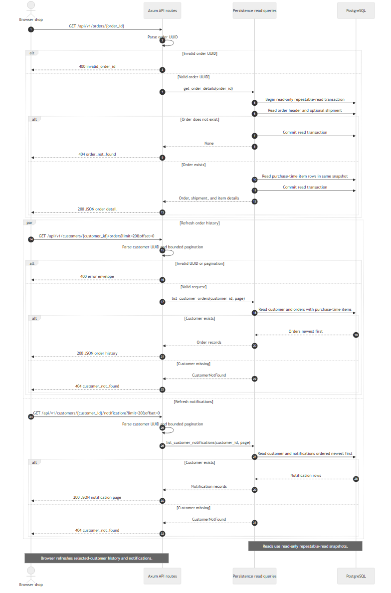

### End-to-end order journey

Connects checkout, outbox publication, inventory acceptance/rejection,
fulfillment, independent notification handling, and browser polling. The
notification consumer reacts to accepted, rejected, and shipped events in its
own consumer group.

Source: [end-to-end.mmd](end-to-end.mmd) · Images: [SVG](images/end-to-end.svg) | [PNG](images/end-to-end.png)

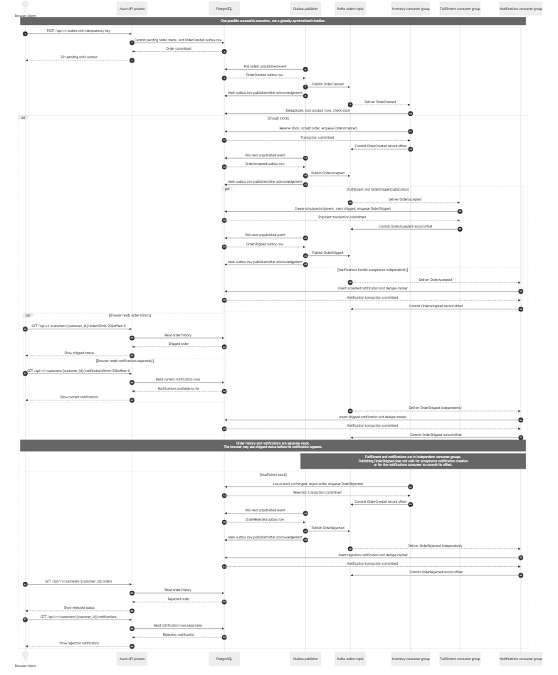

### Consumer crash and redelivery

Shows why the processed-event marker shares a PostgreSQL transaction with
business effects, and how a redelivered record avoids repeating those effects.
It also documents the shared five-minute database retry budget.

Source: [consumer-recovery.mmd](consumer-recovery.mmd) · Images: [SVG](images/consumer-recovery.svg) | [PNG](images/consumer-recovery.png)

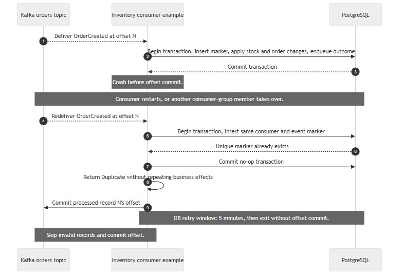

### Two orders compete for the last unit

Shows two inventory replicas locking the same product row. The first
transaction to acquire the lock reserves the last unit; the other observes zero
stock and rejects its order without making stock negative.

Source: [last-unit-race.mmd](last-unit-race.mmd) · Images: [SVG](images/last-unit-race.svg) | [PNG](images/last-unit-race.png)

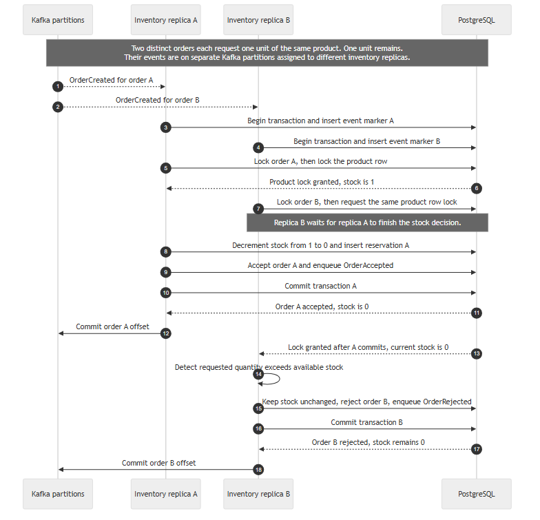

## Regenerate the images

The sources are rendered with the official Mermaid CLI. Node.js and npm are
needed only to regenerate these documentation images; they are not runtime
requirements for the shop. The script uses a pinned CLI version and writes both
SVG and PNG images to `images/`.

From the repository root, run:

```powershell
powershell -NoProfile -ExecutionPolicy Bypass -File docs/diagrams/render.ps1
```

The script uses `npx` to run `@mermaid-js/mermaid-cli@11.17.0`; no project
`package.json` or frontend build step is needed.

## Scope notes

- Order responses are initially `pending`; the inventory worker later accepts
  or rejects the order after checking stock.
- An accepted order is shipped by the fulfillment worker with a visibly
  simulated `SIM-...` tracking reference.
- Each worker commits its Kafka offset after its PostgreSQL work succeeds.
- Invalid records are logged and skipped by the relevant consumer; a durable
  dead-letter or quarantine store is not implemented yet.
- The diagrams summarize behavior and omit SQL column lists and routine
  transport details. If code behavior changes, update the `.mmd` sources and
  regenerate the images.
